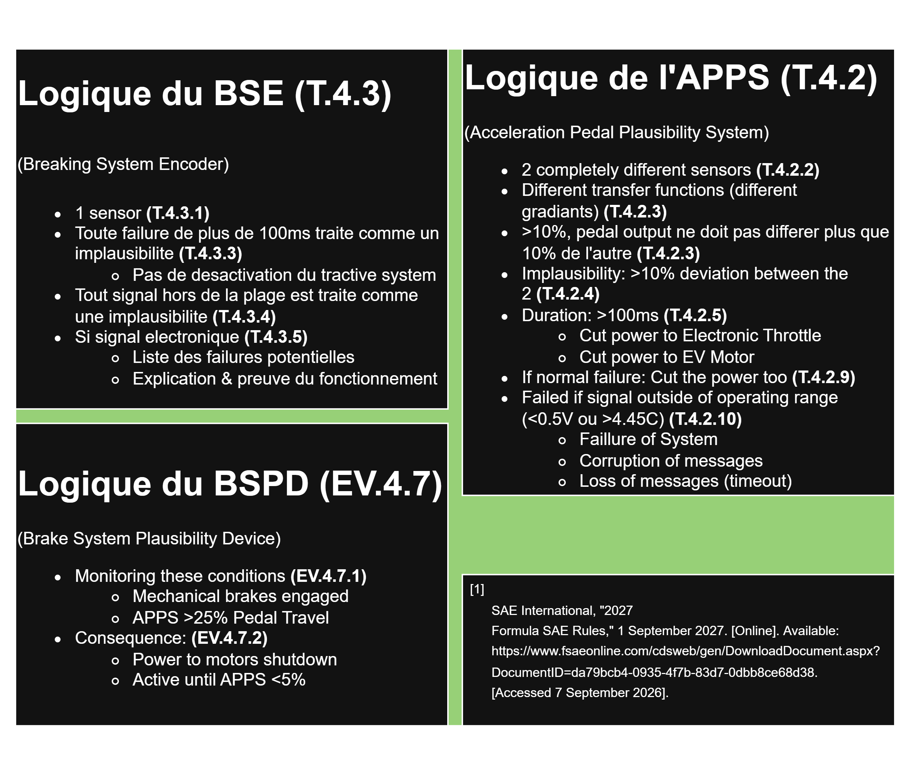
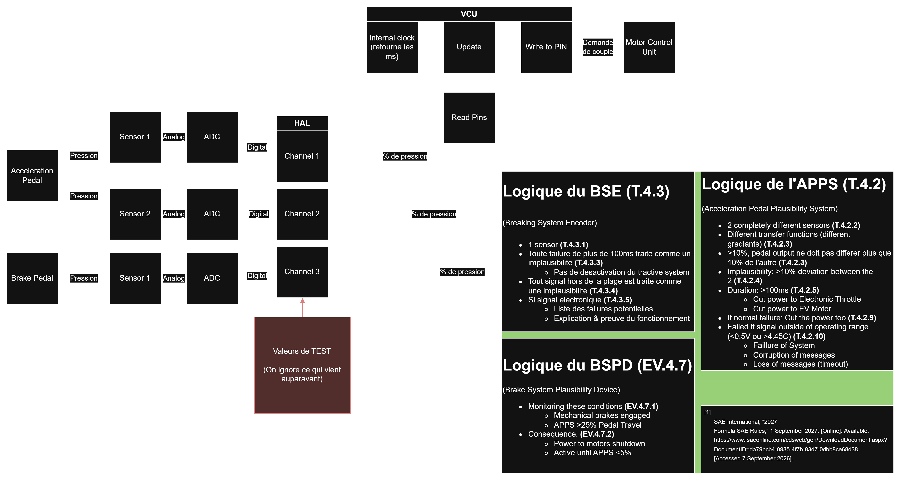

# HAL simule 
_Aucun outil d'intelligence artificielle n'a ete utilise durant le processus de creation du programme Python._
_Gemini Flash-Lite a ete utilise pour traduire la fonction qui cree les listes de test de Python vers C++ ainsi que pour la traduction de la logique du VCU de Python vers C++._

## Version Python
_La version Python est la premiere version creee, surtout pour me simplifier la tache en retirant la limite en lien a la connaissance de C++._

## Lancer le programme: 
1. Run avec interpreteur Python
2. Taper y
3. Taper la quantite de tests qu'on desire effectuer
4. Lancer

### Organisation du fichier 

1. main.py
    Initialise les fichiers et lance la boucle centrale.
2. vcu.py
    La logique du circuit en tant que tel.
    Simule le comportement du VCU.
    C'est ce que le HAL permet de tester.
    Normalement ce fichier aurait besoin de reponses des pins physiques. Le HAL les remplace.
3. hal.py
    Contient les classes des channels.
    Donne une methode permettant aux autres fichiers de lire et d'ecrire sur les channels qu'ils creent.

### Explication de la logique centrale
_La longue explication logique est dans le draw.io._

1. VCU "cree" toutes les channels dont elle a besoin 
2. VCU fais les readings 
3. VCU fais les verifications sur les readings
    + Verification que les readings existent (quand ils n'existent pas dans la simulation c'est None)
    + Verification que les readings sont dans le range
    + Verification que les deux readings d'acceleration sont les memes 
    + S'il y a une erreur, lancement d'erreur et coupe des moteurs 
4. Si tous les readings sont bons, moteur_ready = True
5. Si moteur_ready == True, on lance le calcul de la demande de couple
6. VCU envoie la deamnde de couple sur la channel du moteur

### Etat du projet 
Pour l'instant, la logique fonctionne.
Si le programme entre dans le mode test, une liste d'inputs successifs sera generee et permettra de tester le comportement du programme et devoir ses limites dans les situations suivantes.
1. Tous les sensors augmentent
2. Un sensor d'acceleration augmente 
3. Le sensor des brake augmente
4. Deux sensors d'acceleration augmentent
5. Acceleration augmente de maniere disproportionnee pour le sensor 1s

### Amelioration potentielle 
1. Faire des graphiques qui montrent l'evolution de la pression mise sur les pedales au fil du temps du test.
    + Montrer le resultat sur la demande de couple
    + Montrer ou (precisement, sur un graphique lisible) la demande de couple tombe a zero

## Version C++
_Pour l'instant la version C++ n'est pas encore codee._

